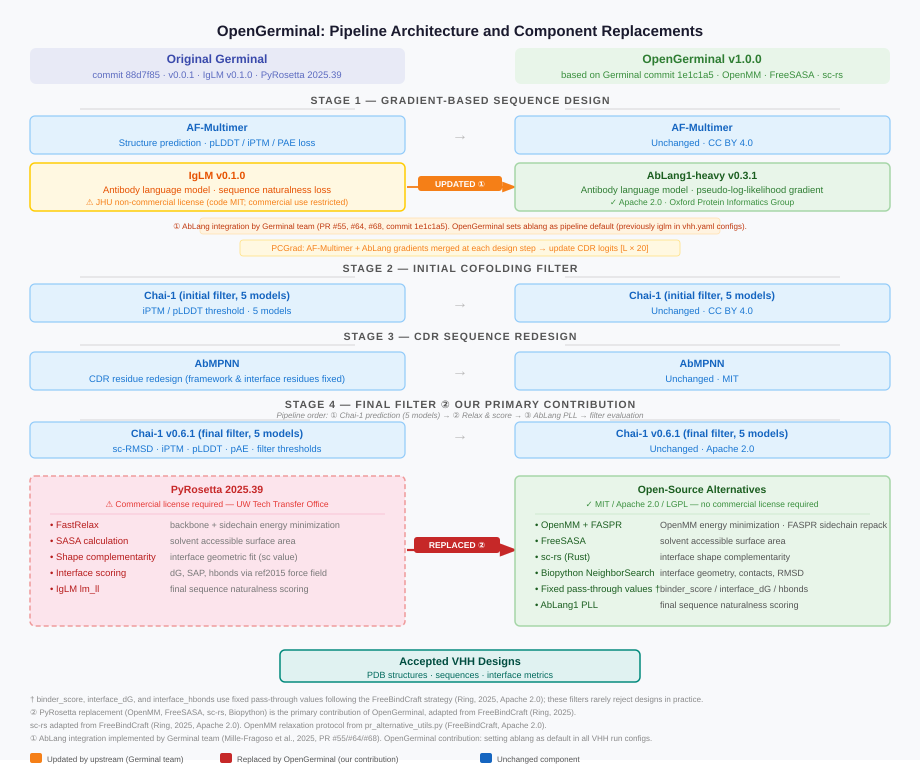

# OpenGerminal

[](LICENSE)
[](https://doi.org/10.64898/2026.06.25.734527)
[-10.5281%2Fzenodo.20755400-blue)](https://doi.org/10.5281/zenodo.20755400)
[-10.5281%2Fzenodo.20756013-blue)](https://doi.org/10.5281/zenodo.20756013)

**A PyRosetta-free implementation of the [Germinal](https://github.com/SantiagoMille/germinal) antibody design pipeline (VHH nanobodies and scFv).**

OpenGerminal replaces PyRosetta — the primary commercial dependency in Germinal — with fully open-source alternatives, enabling the pipeline to be used in academic and commercial settings without software licensing barriers. Upstream Germinal had made AbLang available as a non-default alternative language model before the commit this work forked from, but IgLM remained the default and no comparative data were reported; OpenGerminal adopts AbLang1 as the sole language model for all VHH configurations, removing IgLM entirely. The fork point is commit `1e1c1a5` (24 April 2026, PR #60), which already contained that optional support.

> ⚠️ **Patent notice:** The Germinal methodology is subject to a provisional patent
> application filed by Stanford University and Arc Institute
> (Mille-Fragoso et al., bioRxiv 2025). A provisional patent does not confer
> enforceable rights, but a formal patent may be granted in the future.
> **OpenGerminal removes software licensing barriers (PyRosetta, IgLM) only.**
> Users intending commercial applications are solely responsible for assessing
> compliance with any patent rights that may arise from the Germinal methodology.
> This repository and its authors make no representations regarding the
> patent status of the underlying design method.

> 📄 **Preprint:** Han & Li (2026). *OpenGerminal: an open-source implementation of the Germinal antibody design pipeline.* bioRxiv. https://doi.org/10.64898/2026.06.25.734527

---

## What Changed

| Component | Original Germinal | OpenGerminal | License |
|---|---|---|---|
| Antibody LM (gradient) | IgLM v0.1.0 | AbLang1-heavy weights loaded through ablang2 v0.2.1 *(available upstream at the fork point; adopted in OpenGerminal as the only option)* | BSD 3-clause (package); weights: not stated by the distributor |
| Structure relaxation | PyRosetta FastRelax | OpenMM + FASPR | MIT (FASPR; OpenMM API, Reference and CPU platforms), LGPL-3.0 (OpenMM CUDA and OpenCL platforms) |
| SASA calculation | PyRosetta | FreeSASA 2.2.1 | MIT |
| Shape complementarity | PyRosetta | sc-rs | MIT |
| Interface geometry | PyRosetta | Biopython 1.88 | Biopython License Agreement (BSD-like) |
| Gradient-based design | AF-Multimer | AF-Multimer | CC BY 4.0 |
| Initial & final cofolding filter | Chai-1 v0.6.1 (1 model) | Chai-1 v0.6.1 (1 model) | Apache 2.0 |
| Sequence redesign | AbMPNN | AbMPNN | MIT |

> **Note:** AbLang was already available in Germinal as a non-default alternative language model at this work's fork point; IgLM remained the default and no comparative benchmarking was reported. OpenGerminal adopts AbLang1 as the sole language model, removing IgLM as a selectable option, and provides the first systematic benchmarking of the two models within this architecture.

> **Known approximations (inherited from [FreeBindCraft](https://github.com/cytokineking/FreeBindCraft)):** eight interface quantities depend on the Rosetta force field, have no open-source equivalent, and carry fixed values: `binder_score` (-1.0), `interface_dG` (-10.0), `interface_dG_SASA_ratio` (0.0), `interface_hbonds` (5), `interface_hbond_percentage` (60.0), `interface_delta_unsat_hbonds` (1), `interface_delta_unsat_hbonds_percentage` (0.0) and `interface_packstat` (0.65). All eight are inherited verbatim from FreeBindCraft's `functions/pr_alternative_utils.py`, values and stated rationale unchanged; none was introduced by this work. Of the eight, only `interface_hbonds` is applied as a filter threshold, a Stage 4 gate that the fixed value always passes, effectively disabling it; the other seven are recorded for reference only. `binder_score` is also used by the Stage 2 ensemble-selection logic, which is degraded as a result (all candidates appear identical, so the first is always selected rather than the energetically optimal one); practical impact is expected to be limited.
>
> **Two further placeholders come from Germinal rather than from FreeBindCraft**, and are present in every configuration because every configuration co-folds with Chai-1: `chain_ptm` and `chain_iptm` are set to the constant 1 in `germinal/filters/chai.py`. `chain_ptm` is written to the per-design record as a constant column; `chain_iptm` is set in the code but never written to the record. Neither is named by any filter, so no acceptance decision depends on either.

---

## Pipeline Overview



---

## Requirements

- Linux x86_64
- NVIDIA GPU with ≥ 40 GB VRAM (A100 recommended)
- Apptainer / Singularity
- AF-Multimer parameters (see below)
- Chai-1 weights (auto-downloaded on first run)

---

## Installation

### 1. Download the container

```bash
# Option A: Download pre-built container (recommended)
# Download opengerminal_v1.0.0.sif (6.1 GB) from Zenodo:
# https://doi.org/10.5281/zenodo.20756013

# Option B: Build from source
git clone https://github.com/teaninja/OpenGerminal.git
cd OpenGerminal
docker build -f Dockerfile.free -t opengerminal:v1.0.0 .
docker save opengerminal:v1.0.0 | gzip > opengerminal_docker.tar.gz
# Convert to sif on HPC:
apptainer build --fakeroot opengerminal_v1.0.0.sif docker-archive://opengerminal_docker.tar.gz
```

### 2. Download AF-Multimer parameters

```bash
mkdir -p params && cd params
aria2c -q -x 16 https://storage.googleapis.com/alphafold/alphafold_params_2022-12-06.tar
tar -xf alphafold_params_2022-12-06.tar
rm alphafold_params_2022-12-06.tar
```

Alternatively, extract from an existing `germinal.sif`:
```bash
apptainer exec germinal.sif tar -cf params_from_sif.tar /workspace/params
tar -xf params_from_sif.tar --strip-components=2 -C params/
```

### 3. Prepare AbLang weights directory

AbLang weights are downloaded automatically on the first run. Provide a writable directory:

```bash
mkdir -p ablang_weights
```

---

## Usage

### Directory structure

```
/your/workdir/
  opengerminal_v1.0.0.sif
  params/                    ← AF-Multimer parameters
  pdbs/
    nb.pdb                   ← VHH framework template
    <antigen>.pdb             ← target antigen structure
  chai_cache/                ← Chai-1 weights (auto-downloaded)
  ablang_weights/            ← AbLang weights (auto-downloaded)
  results/                   ← output directory
  <jobname>/
    <target>.yaml            ← target configuration
    run.sh                   ← SLURM submission script
```

### Target configuration (YAML)

```yaml
target_name: pdl1
target_pdb_path: pdbs/pdl1.pdb
target_chain: A
binder_chain: B
target_hotspots: A37,A39,A41,A96,A98
hotspot_residue: W40
dimer: false
structure_model: chai
```

### SLURM submission script

```bash
#!/bin/bash
#SBATCH -p gpu
#SBATCH --gres=gpu:a100:1
#SBATCH --nodes=1
#SBATCH -c 8
#SBATCH --mem=80G
#SBATCH --time=12:00:00
#SBATCH --account=<your_account>

cd /your/workdir
module load apptainer

apptainer exec --nv \
  --bind $PWD/params:/workspace/params \
  --bind $PWD/results:/workspace/results \
  --bind $PWD/pdbs:/workspace/pdbs \
  --bind $PWD/chai_cache:/opt/conda/envs/germinal/lib/python3.10/site-packages/downloads \
  --bind $PWD/ablang_weights:/opt/conda/envs/germinal/lib/python3.10/site-packages/ablang2/model-weights-ablang1-heavy \
  --bind $PWD/<jobname>/<target>.yaml:/workspace/configs/target/<target>.yaml \
  --pwd /workspace \
  opengerminal_v1.0.0.sif \
  python run_germinal.py target=<target> experiment_name=<exp> structure_model=chai
```

---

## Benchmark

The v1.0.0 release reported a pass-rate comparison against a prebuilt image of
upstream Germinal. **That comparison is superseded.** It crossed three
differences at once, the scoring stack, the language model, and six months of
upstream development, and the factorial design that separates them finds the
difference in co-folding entry to follow the language model, with the two
scoring stacks identical on that measure. The v1.0.0 figures are therefore not
reproduced here.

The current benchmark is five targets by four arms. Its numbers, the methods,
and the thresholds they were read against are in the accompanying paper and in
the archived run records rather than in this file, so that one set of figures
exists in one place and no copy here can fall behind it.

What does not depend on a benchmark:

| | Original Germinal | OpenGerminal |
|---|---|---|
| PyRosetta required | yes | no |
| IgLM required | yes | no |
| Commercial use | a licence is required for PyRosetta and for IgLM | no component forbids it; see the licence table below |

---

## License

© 2026 by the Rector and Visitors of the University of Virginia. All rights reserved.

OpenGerminal code modifications are released under the **Apache 2.0 License**. See [LICENSE](LICENSE) for full text.

### Software dependencies

The open-source components introduced in this work are distributed under the following licenses:

| Component | License |
|---|---|
| OpenMM 8.6.0 | MIT (API, Reference and CPU platforms); LGPL-3.0 (CUDA and OpenCL platforms). The released default is the CPU platform; see `licenses/Licenses.txt` inside the image |
| FASPR | MIT License (upstream `LICENSE` file; the upstream README states Apache 2.0 and the two disagree — the LICENSE file is taken as governing, and both readings permit commercial use) |
| FreeSASA 2.2.1 | MIT License (FreeSASA relicensed from LGPL to MIT at version 2.0, so the LGPL figure described a version we do not ship) |
| sc-rs v1.0.0 | MIT License |
| Biopython 1.88 | Biopython License Agreement (BSD-like) |
| mdtraj 1.10.3 | LGPL-2.1-or-later. Imported by `germinal/filters/pDockQ.py`. Installed as an ordinary conda package and therefore replaceable, which is what the LGPL asks for; its notice is retained and the binary is unmodified |
| ablang2 v0.2.1 | BSD 3-clause |

### Patent disclaimer

The Germinal pipeline methodology is subject to a provisional patent application
filed by Stanford University and Arc Institute. Provisional patents do not yet
confer enforceable rights, but a formal patent may be granted in future.
This notice is provided for transparency; it is not legal advice.
**Users are solely responsible for determining whether their intended use
requires a patent license from the relevant rights holders.**

This repository builds upon:
- [Germinal](https://github.com/SantiagoMille/germinal) (Apache 2.0) — Mille-Fragoso et al., 2025
- [FreeBindCraft](https://github.com/cytokineking/FreeBindCraft) (MIT) — Ring, 2025. The text shipped at `germinal/filters/LICENSES/BindCraft-FreeBindCraft.LICENSE` is FreeBindCraft's own, which is an unmodified copy of BindCraft's (© 2024 Martin Pacesa)
- [AbLang2](https://github.com/oxpig/AbLang2) (BSD 3-clause) — Oxford Protein Informatics Group
- [OpenMM](https://openmm.org) (MIT)
- [FreeSASA](https://freesasa.github.io) (MIT; relicensed from LGPL at version 2.0, and the version shipped here is 2.2.1)

---

## Citation

If you use OpenGerminal, please cite:

```bibtex
@article{opengerminal2026,
  title   = {OpenGerminal: an open-source implementation of the Germinal antibody design pipeline},
  author  = {Han, Bing and Li, Sheng},
  journal = {bioRxiv},
  year    = {2026},
  doi     = {10.64898/2026.06.25.734527},
  url     = {https://doi.org/10.64898/2026.06.25.734527}
}
```

Please also cite the original Germinal paper:

```bibtex
@article{germinal2025,
  title   = {Efficient generation of epitope-targeted de novo antibodies with Germinal},
  author  = {Mille-Fragoso, Santiago and others},
  journal = {bioRxiv},
  year    = {2025},
  doi     = {10.1101/2025.09.19.677421}
}
```

---

## Affiliation

Department of Molecular Physiology and Biological Physics, University of Virginia School of Medicine  
[Kenworthy Lab](https://med.virginia.edu/kenworthy-lab/)

*This work was conducted as part of research activities in the Kenworthy Lab.*

---

## Acknowledgments

OpenGerminal is built on the work of the Germinal team (Santiago Mille-Fragoso et al.) and draws on the PyRosetta-free approach pioneered by FreeBindCraft (Aaron Ring, Ariax Bio). We thank both teams for making their work open source.

OpenGerminal also redistributes seven third-party files in `germinal/filters/`, all from [FreeBindCraft](https://github.com/cytokineking/FreeBindCraft) under the MIT License: four Python modules (`pr_alternative_utils.py`, `biopython_utils.py`, `generic_utils.py` and `logging_utils.py`) and three binary or data files (`FASPR`, `sc` and `dun2010bbdep.bin`). `FASPR` and `sc` are built from projects of their own, whose terms are reproduced separately: FASPR (Xiaoqiang Huang, MIT) and sc-rs (MIT). The third is the Dunbrack 2010 backbone-dependent rotamer library, which FASPR requires beside its executable; we acknowledge the Dunbrack laboratory as its source. The terms for all seven are in `germinal/filters/LICENSES/`.

The AbMPNN model weights redistributed at `colabdesign/colabdesign/mpnn/weights_abmpnn/abmpnn.pkl` are the work of Frederic A. Dreyer, Daniel Cutting, Constantin Schneider, Henry Kenlay and Charlotte M. Deane, published at [10.5281/zenodo.8164693](https://doi.org/10.5281/zenodo.8164693) under [CC BY 4.0](https://creativecommons.org/licenses/by/4.0/). The file here is a format conversion of the published `abmpnn.pt` checkpoint; see `germinal/filters/LICENSES/AbMPNN-weights.NOTICE`.
